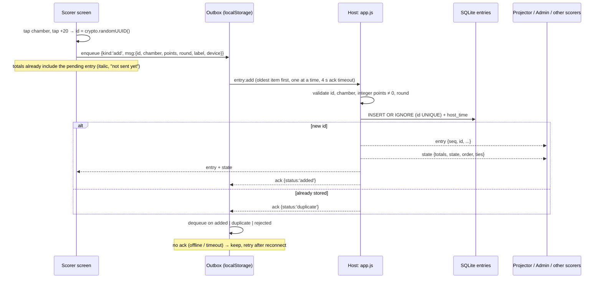

# Architecture

For the developer. What the pieces are, how a tap travels, and why it is built this way. File references are to the current code.

## Components

| Component | Where | Role |
| --- | --- | --- |
| Server | `server/src/index.js`, `app.js` | One Node process on the host. Express serves the built screens and chamber files; Socket.IO carries everything else. Binds `0.0.0.0:3000`. |
| Score log | `server/src/scoreLog.js` | SQLite (`better-sqlite3`), one `entries` table, append-only by trigger. Also a tiny `game_state` key/value table. |
| Game state | `server/src/gameState.js` | Round, timer, tie picks, hidden flag, music, effects, podium. Saved as one JSON blob in `game_state`. |
| Backup / restore | `server/src/backup.js`, `restore.js` | Minute copies of the database plus a standings CSV; copying a backup into place before start. |
| Chambers | `server/src/chambers.js`, `data/chambers.csv` | Tiny CSV reader; resolves logo/song paths to URLs if the files exist. |
| Supervisor | `scripts/supervisor.js`, `start-scoreboard.bat` | Restarts the server on crash, prints the LAN URL after `/api/health` answers. |
| Client core | `client/src/useScoreboard.js`, `outbox.js`, `entries.js` | One React hook per screen: socket, mirror of the log, outbox of unsent items, derived totals. |
| Screens | `client/src/scorer/`, `admin/`, `projector/`, `history/` | Picked by URL path in `client/src/App.jsx`. |
| Shared helpers | `shared/*.js` | Pure functions used by server, client and tests: ranking, timer maths, leader-song tracker, effects engine, effects queue. |
| Config | `shared/scoring.json`, `settings.json`, `effects.json` | Read once at server start and shipped to clients in the snapshot. |

## Data flow: from a tap to every screen

Key points:

- **The id is made on the client** (`useScoreboard.js:98`). The host's `INSERT OR IGNORE` on a `UNIQUE` id (`scoreLog.js:10,28`) is the whole duplicate defence. Resends, double taps and replays after reconnect are all harmless.
- **The outbox leaves nothing in doubt.** An item is removed only when the host answers `added`, `duplicate` or `rejected` (`outbox.js:21`, `useScoreboard.js:66-76`). A timeout or disconnect keeps it. It survives reloads in `localStorage` under `gof-outbox`.
- **Clients never trust their own arithmetic for long.** Every connect (first or re-) gets a full `snapshot` with every entry and the host's totals (`app.js:52-54, 68`). The client replaces its mirror with it (`useScoreboard.js:42-48`). Between snapshots it appends `entry` events and overwrites totals from `state` events.
- **Host time only.** `state.hostNow` comes with every snapshot and state; clients keep an offset and compute the timer from it (`useScoreboard.js:43, 54, 91`, `shared/timer.js`).

## The score log and the void model

Table `entries` (`scoreLog.js:8-19`):

| Column | Meaning |
| --- | --- |
| `seq` | Autoincrement. Order of arrival at the host. |
| `id` | Client-made UUID. `UNIQUE`. |
| `chamber`, `points`, `round`, `label`, `device` | What the scorer sent. `label` is the button group label or the pad label. |
| `host_time` | ms since epoch, host clock. |
| `voids` | `NULL` for a score entry. For an undo, the `id` of the entry it cancels. `UNIQUE` where not null, so an entry can be voided once. |

Rules enforced in SQL: `BEFORE UPDATE` and `BEFORE DELETE` triggers abort with "score log is append-only" (`scoreLog.js:20-23`, tested in `scoreLog.test.js:50`).

**Undo** inserts a row with `points = 0`, `voids = <target id>`, `label = "void of <id>"` (`scoreLog.js:46-56`). It is rejected if the target is missing, is itself a void, or is already voided. A void cannot be undone; you score again instead.

**Totals** are never stored. They are one query over the log: sum of `points` where `voids IS NULL` and the id is not referenced by any void (`scoreLog.js:59-70`). The client does the same in JavaScript over its mirror plus outbox (`client/src/entries.js`). Restart recovery is therefore free: open the file, run the query.

**Game state** (`gameState.js`) is a single JSON value under key `game` in `game_state`, overwritten on every change. It is not part of the log and is not append-only.

## Ranking and ties

`shared/ranking.js` sorts by total descending, then id. Chambers with equal totals form a group. Picks from `tieOrder` that belong to the group come first, in pick order; the rest stay in id order. If more than one chamber is still unpicked in a group whose next place is 1 to 3, that group is reported in `ties`. The admin's **Tied chambers** box and the podium guard (`app.js:144-149`) use `ties`.

## Socket.IO events

Server → client:

| Event | To | Payload |
| --- | --- | --- |
| `snapshot` | the connecting socket | `{ chambers, scoring, settings (without PIN/backup keys), effects, totals, entries (all), state, order, ties }` |
| `entry` | everyone | one new row (score or void) |
| `state` | everyone | `{ totals, state, order, ties }` after any score or state change |
| `laptops` | admins | list of connected sockets: `{ id, role, label, since, unsent }` |
| `effects:preview` | projectors | `{ name, chamber }` |

Client → server (with acknowledgement callbacks where noted):

| Event | Who | Payload → ack | Guard |
| --- | --- | --- | --- |
| `entry:add` | scorer, admin | `{ id, chamber, points, round, label, device }` → `{ status: added \| duplicate \| rejected }` | id 1-100 chars, known chamber, integer points ≠ 0, known round id (`app.js:73`) |
| `entry:void` | scorer, admin | `{ id, voids, device }` → `{ status }` | ids valid; target rules above |
| `sync:since` | load test only | `seq` → `{ entries, totals }` | none. The browser client does not use it; it relies on `snapshot`. |
| `hello` | every screen | `{ role, device, unsent }` | role must be scorer/admin/projector/history |
| `admin:login` | admin | `pin` → `{ ok, locked? }` | 5 failures → 10 s global lock (`app.js:106-116`) |
| `round:set` | admin | round id → `{ ok }` | admin only |
| `timer:start`, `timer:pause`, `timer:reset` | admin | seconds (start/reset) | admin only |
| `scores:hide` | admin | boolean → `{ ok }` | admin only |
| `music:set` | admin | `{ volume?, muted? }` → `{ ok }` | admin only |
| `effects:set` | admin | `{ on?, intensity? }` → `{ ok }` | admin only |
| `effects:preview` | admin | `{ name, chamber }` → `{ ok }` | admin only; name in `PREVIEW_IDS` |
| `podium:set` | admin | 0-3 → `{ ok }` | admin only; refused while a podium tie is open and n would grow |
| `tie:pick`, `tie:undo`, `tie:clear` | admin | chamber id (pick) → `{ ok }` | admin only; pick must be in an open tie |

"Admin only" means `socket.data.admin` was set by a successful `admin:login` on that socket (`app.js:119-124`). Non-admins get `{ ok: false, denied: true }`.

HTTP routes (`app.js:38-48`): `GET /api/health` → `{"ok":true}`; `GET /chamber-assets/*` from `client/assets/chambers/`, 404 if missing; everything else from `client/dist`, falling back to `index.html` so `/admin`, `/projector`, `/history` load the app.

## Backup and recovery

- `createBackup` (`backup.js:35`) runs once at start and every 60 s. It uses SQLite's online backup API into a temp file, opens that copy to compute standings (so the CSV always matches the copy), renames both into place, and keeps a stamped pair only when `[entry count, game state]` changed. Failures are logged and swallowed: a missing USB drive never stops scoring.
- `restoreBackup` (`restore.js:30`) runs before the database is opened. It integrity-checks the source, refuses to overwrite a local log with entries unless `--force`, moves the old one aside, and copies via temp-and-rename.
- The supervisor passes `--from-backup`/`--force` only on the first spawn (`supervisor.js:79-82`), so a crash-restart never re-restores.
- Exit code 2 from the server means "setup problem" and stops the restart loop (`index.js:15`, `supervisor.js:26-29`).

## Design decisions

| Decision | Why |
| --- | --- |
| Client-made ids and `INSERT OR IGNORE` | Exactly-once without any handshake: the client can resend blindly. |
| Full snapshot on every connect instead of delta sync | Simpler and always correct. A few hundred to a few thousand rows is small. `sync:since` exists but only the load test uses it. |
| Totals recomputed from the log | No stored total can drift from the log; restart recovery and backups need no extra logic. |
| Undo as a row, not a delete | The history shows what happened; nothing can be hidden; the DB triggers make the guarantee. |
| Game state as one JSON blob | Round, timer and picks are tiny and change rarely. |
| Host time for timers | Laptop clocks disagree; one clock means one countdown. |
| Config read at start and shipped in the snapshot | No client rebuild to change a button value; the only cost is a server restart. |
| Effects engine as a pure module (`shared/effects.js`) | Testable without a browser; the projector only renders what it returns. A snapshot resets it quietly so replays never fire effects. |
| Music decided on the projector (`shared/leader.js`) | Only the projector has speakers; the admin only sets volume and mute. The hold timer uses the projector's own clock because it is a UI delay, not a game timer. |
| No build step on event day | `client/dist` (git-ignored) travels with the folder copy; the server serves static files. |
| Everything bundled | No CDN, no web fonts, no external URLs anywhere in `client/`, `server/`, `shared/` or the built bundle (verified by grep). |

## What is deliberately not here

No question pool, Trebles, attacks, power-ups or rule checks. The server validates only that an entry is well-formed. The only "rule-like" logic is the podium guard (do not reveal a place while a tie for it is open), which protects the show, not the game.
